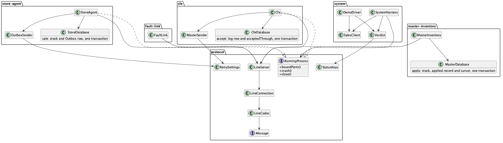
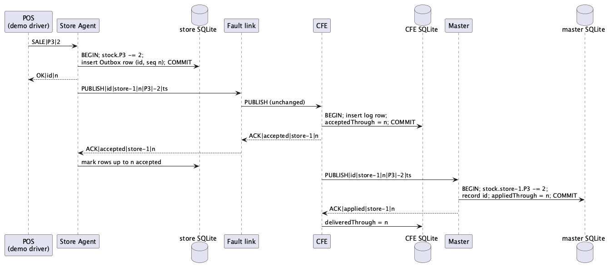
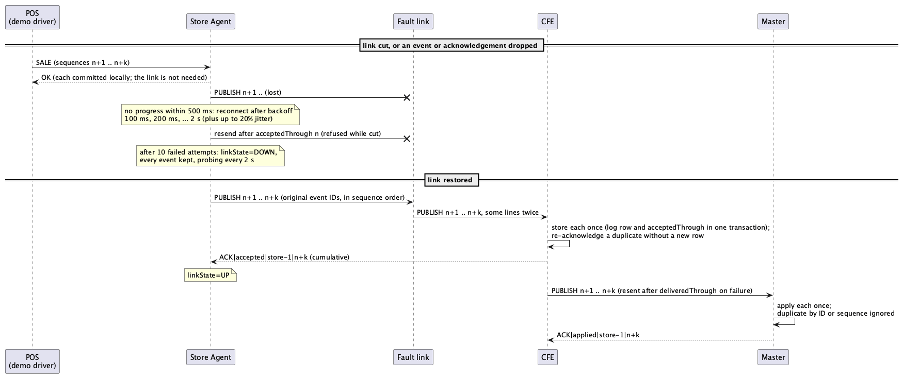

We implement one pattern, a **transactional outbox with an idempotent consumer**, for scenario
AV-2. For long-form rationale this document points to our architecture document.

## Scenario and tactics

- **AV-2, rated (H, H).** Source: the store-to-DC link or the central system (transient fault).
  Stimulus: an event, or the confirmation of its receipt, is lost between a store and the central
  system. Response: the store keeps the event and sends it again with its original identifier
  until the central system confirms it; the central system discards duplicates by event
  identifier. Response measure: **"100% of store events reach the DC; 0 events lost; 0 events
  applied twice."**
- **Transactions** (*Software Architecture in Practice*, 4th ed., p. 61): the book's tactic gives
  the exchange of messages between distributed components the ACID properties, so a step either
  happens completely or not at all. In our code every state change that matters is one SQLite
  transaction, and a process acknowledges only after its transaction commits.
- **Retry** (p. 60): the book's tactic assumes the fault that caused a failure is transient, so
  repeating the operation may succeed. Our two senders (store to CFE, CFE to master) resend every
  unacknowledged event with its original ID until it is acknowledged; the receivers make the
  resend safe by ignoring what they already hold.
- **Interface implemented** from the architecture document: publish, cumulative `accepted` and
  `applied` acknowledgements, the event identity and the per-source sequence. **Not implemented**:
  subscribe, replay-from-sequence, resync, topics and retention. For these faults, resending
  everything after the receiver's last acknowledged position plays the role our document gives to
  replay.

## Classes

{width=100%}

## Normal path and outage-and-resend path

{width=100%}

{width=100%}

## Implementation decisions

**Transaction boundary in each process**

- **Store Agent** (Godson Umoren). One SQLite transaction per sale: subtract the quantity from the
  product's stock, insert the Outbox row (new event ID, next sequence number, product,
  `delta` = -quantity, UTC timestamp, not yet accepted) and advance the sequence. Only after the
  commit does the store answer `OK|eventId|sequence`, so stock and Outbox never disagree and no
  sequence number is used up or reused. Sales are accepted whether or not the link is up. Each
  cumulative `ACK|accepted|source|through` marks rows up to `through` accepted; a stale or
  duplicate acknowledgement never moves the position back. A restarted store sends from
  accepted-through + 1 and asks the CFE nothing. Initial stock is seeded once, when the file is
  created.
- **Fault link** (Leon Letournel). Forwards each line in both directions unchanged, so
  acknowledgements get the same faults as events. A reader thread decides each line's fate and a
  writer thread sends it at its due time in queue order, so a delay never reorders lines.
  `SET|drop|<0-100>`, `SET|duplicate|<0-100>` and `SET|delay|<ms>` use one `java.util.Random`
  seeded by `inventory.link.seed` (default 755). `CUT` closes every connection and refuses new ones
  until `RESTORE`; queued lines are lost, as on a broken network. The link has no storage.
- **CFE** (Kobe LaPrade). The event-log row and its source's accepted-through position commit in
  one transaction, and only then does the CFE send `ACK|accepted|source|through`. It accepts only
  the next contiguous sequence per source; an ID it already holds, or a sequence at or below
  accepted-through, is re-acknowledged without another row; an event beyond a gap is not stored
  and the reply gives the current position. It forwards stored events to the master in sequence
  order, and only an advancing cumulative `ACK|applied` moves durable delivered-through. On restart
  it resumes from delivered-through + 1.
- **Master** (Mike Andrews). `MasterDatabase.apply` adds the event's signed `delta` to stock,
  records its ID and source sequence, and advances the cursor in one transaction; the
  `ACK|applied` goes out after the commit. A recorded ID or a sequence at or below the cursor
  returns the saved position and counts in `duplicatesIgnored`; an event ahead of the next sequence
  returns the current position so the CFE resends the missing ones. Stock starts at 1,000,000 per
  product once, when the database is created.

**Retry policy** (`RetrySettings.DEFAULTS`, the same for both senders)

- At most 100 unacknowledged events in flight, in sequence order.
- No progress within 500 ms, or a failed connection: reconnect after a backoff of 100 ms doubling
  to 2 s, each wait lengthened by up to 20% jitter, and resend everything after the last
  acknowledged position with the original event IDs.
- After 10 consecutive failed attempts the sender marks the link `DOWN`, keeps every event and
  keeps probing every 2 s; the first acknowledgement that moves the position marks it `UP`.
- Each setting can be overridden with a system property such as
  `-Dinventory.retry.ackTimeoutMs=50`; the end-to-end tests use a compressed copy.

**Why not two-phase commit**

- Two-phase commit across store, CFE and master would make every sale wait for the WAN and for
  the DC to vote. During a link cut no sale could commit, which breaks AV-1 (the store keeps
  selling with the WAN down). The outbox commits locally at once and moves the WAN out of the sale's
  path; at-least-once resend plus idempotent apply gives the same end state as exactly-once.
- A coordinator crash in two-phase commit can also leave participants blocked holding locks. Our
  processes never wait on each other to commit.

**How we check it**

- The demo driver and the end-to-end tests compute the verdict only from durable STATUS keys,
  after a drain gate (store `pending` 0, CFE `deliveredThrough` = `acceptedThrough`, master
  `appliedThrough` = CFE `acceptedThrough`): lost = store `created` - master `applied`; applied
  twice = master `appliedTwice`; stock match = store `stock.Pn` equals master `stock.store-1.Pn`
  for every product, an additional cross-check.

## Verdict from a real run

`scripts/demo.sh` on macOS, default two-minute profile: normal; drop 20% and duplicate 10%; link
cut for 30 s while sales continue; store, CFE and master each killed with `kill -9` and
restarted. The store's in-memory counters are printed right after the cut, because the store
restart that follows sets them back to zero. The one sale without a reply was sent while the
store was down; it was never recorded and is not retried, so it is not an event.

```
driver stopped: 5103 sales sent, 5102 recorded, 1 without a reply (not retried)
store after the cut: salesWhileDown=867 linkDownEpisodes=1 retriesSent=3007

VERDICT (durable STATUS keys only)
  drain gate                         passed (store pending 0; CFE delivered = accepted = master applied)
  events created at the store        5102
  events applied at the master       5102
  AV-2 response measure:
    100% of store events reach the DC  100% (lost = created - applied = 0)
    0 events lost                      0
    0 events applied twice             0
  additional cross-check:
    store stock = master stock, P1-P5  yes
      P1  store 997981  master 997981
      P2  store 997880  master 997880
      P3  store 998096  master 998096
      P4  store 997975  master 997975
      P5  store 997925  master 997925
  informational (in memory, reset when a process restarts):
    sales while the link was down      0
    retries sent (store / CFE)         80 / 0
    duplicates ignored (CFE / master)  0 / 0
    link-down episodes                 0

PASS  100% of store events reach the DC; 0 events lost; 0 events applied twice
```
